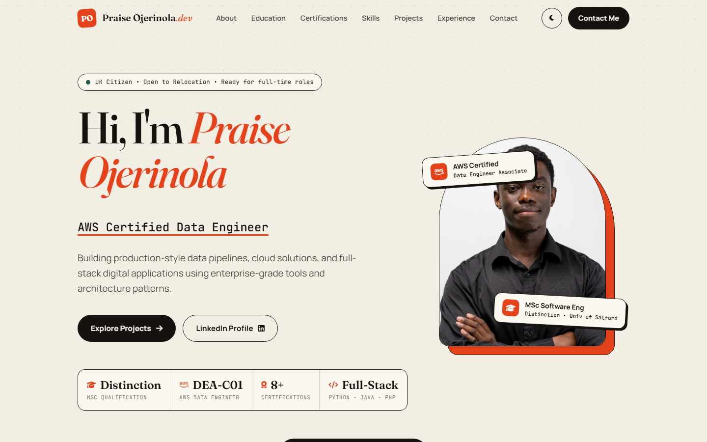
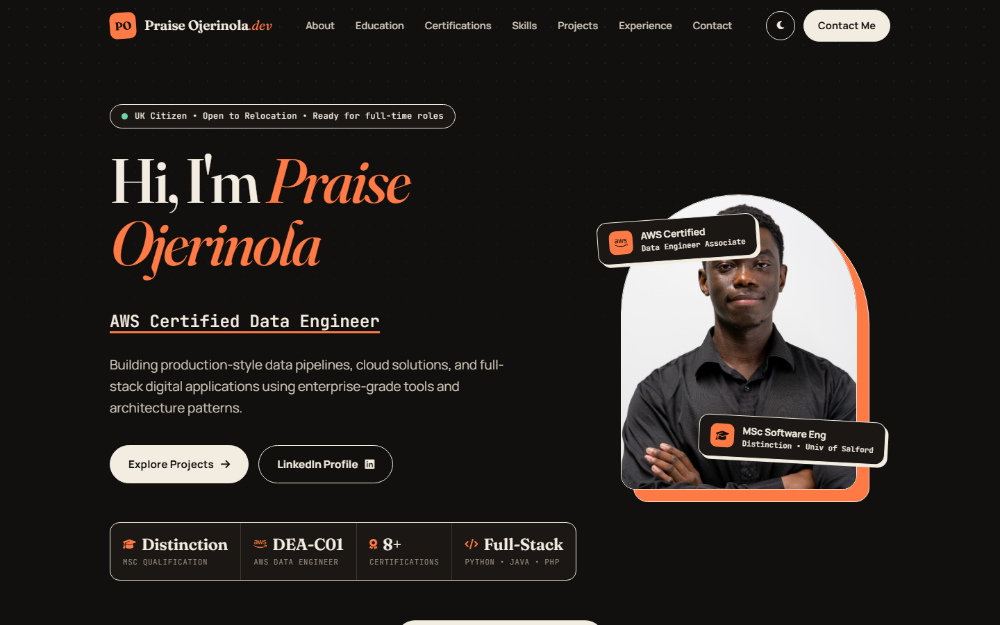
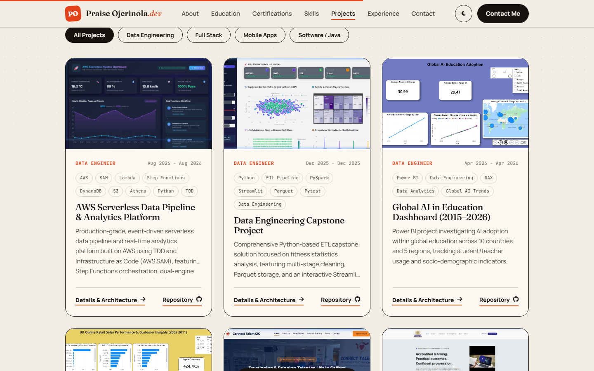
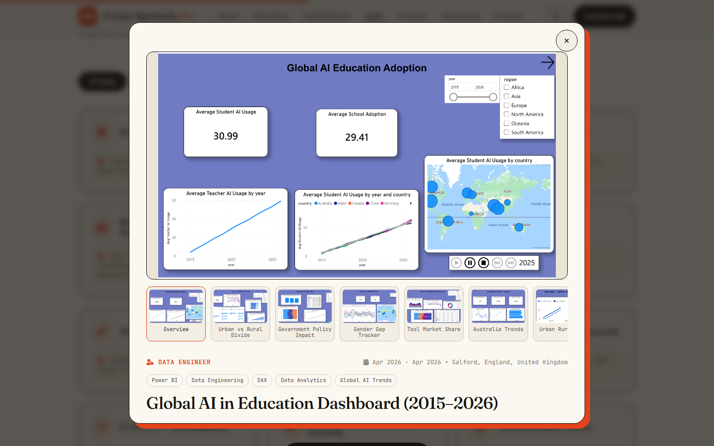
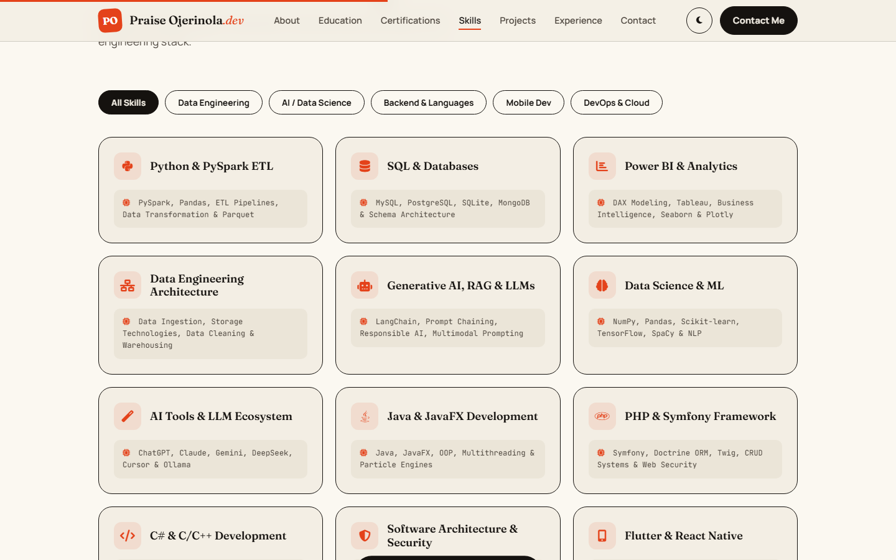
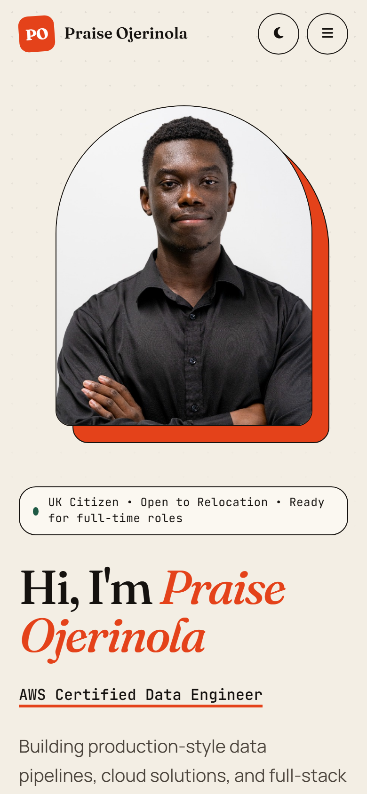
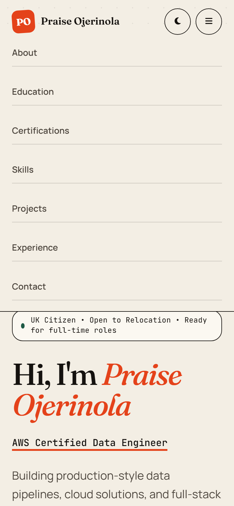

# Praise Ojerinola — Portfolio Website

[](https://praiseojay.github.io/Portfolio_website/)
[](https://www.credly.com/badges/53369df2-187c-4b08-9ed8-18911445242d/public_url)
[](LICENSE)

A personal portfolio built with plain HTML, CSS and JavaScript: no framework and no build step. It has a warm editorial "paper and ink" design in light and dark, content that reveals as you scroll, and a layout that works from a 320 px phone up to a wide desktop.

**Live:** <https://praiseojay.github.io/Portfolio_website/>

---

## 📸 Previews

### Hero (light)


### Hero (dark)


### Projects and case studies


### Project detail with gallery


### Skills


### On a phone
<p>
  
  &nbsp;&nbsp;
  
</p>

---

## ✨ Features

- **Scroll-triggered page:** sections and cards reveal as they enter the screen, the hero drifts as you scroll, stats count up, the experience line draws itself, and a side rail shows which section you are in. Everything simply shows, with no motion, for visitors who prefer reduced motion (`js/scroll.js`).
- **Light and dark themes:** follows the visitor's system setting on first visit and remembers their choice. The theme is set before the page paints, so there is no flash.
- **Mobile-friendly:** checked with no sideways scrolling from 320 px to 1024 px. The navigation collapses into a menu, tap targets are at least 44 px on touch screens, form fields stay at 16 px so iOS does not zoom, and the hero, stats, cards and project modal all reflow.
- **Projects with filtering and detail pages:** filter by category, open any project for its full description, features, metrics, screenshots gallery, and GitHub and live links.
- **Verified credentials:** certifications link straight to their public Credly or issuer pages.
- **Contact form with spam protection:** sends through FormSubmit, with a hidden honeypot field and a mail-app fallback.
- **Accessible and search-friendly:** skip link, visible focus states, labelled controls, descriptive alt text, Open Graph and Schema.org `Person` data, a favicon set and a web manifest.
- **Content driven by data:** the text, education, certifications, skills and experience come from data files rather than being typed into the page (see below).

---

## 🛠️ Technology

- **Core:** HTML5, CSS3 (custom properties for the two themes, grid and flexbox), vanilla JavaScript (ES6+)
- **Type:** Fraunces (display), Manrope (text) and JetBrains Mono (labels) from Google Fonts
- **Icons:** Font Awesome 6
- **Motion:** `IntersectionObserver` and `requestAnimationFrame`, no animation library
- **Hosting:** GitHub Pages, served straight from `main`

---

## 📂 Structure

```
Portfolio_website/
├── assets/
│   ├── images/              # Project screenshots, portrait, README previews
│   ├── favicon.svg          # Site icon (vector)
│   ├── favicon-16.png, favicon-32.png, apple-touch-icon.png, icon-192.png, icon-512.png
├── css/
│   └── styles.css           # Design tokens, light and dark themes, layout, components, responsive rules
├── js/
│   ├── config.js            # Default profile, education, certifications, skills and experience
│   ├── data/
│   │   ├── projects.js      # Curated projects (images, links, case studies)
│   │   └── cv.js            # Generated from the CV; overrides config.js when present
│   ├── main.js              # Renders the page, filters, modal, theme toggle, contact form
│   └── scroll.js            # Scroll-triggered reveals, parallax, counters, section rail
├── favicon.ico
├── site.webmanifest
├── index.html
└── LICENSE
```

### How the content is kept up to date

`js/config.js` holds sensible defaults. When my CV changes, a script writes `js/data/cv.js`, and the page uses it in place of the matching defaults. Text from that file is escaped before it is shown, so it can never inject markup. Projects stay hand-curated in `js/data/projects.js` because they need screenshots and links. The public pages deliberately leave out my phone number and street address.

---

## 🚀 Featured projects

### AWS Serverless Data Pipeline & Analytics Platform
Event-driven serverless pipeline and real-time analytics platform on AWS, built test-first with Infrastructure as Code (AWS SAM): Step Functions orchestration, S3 Parquet plus DynamoDB storage, Athena SQL, and a Chart.js dashboard.
- **Live demo:** [praiseojay.github.io/aws-serverless-data-pipeline](https://praiseojay.github.io/aws-serverless-data-pipeline/)
- **Code:** [aws-serverless-data-pipeline](https://github.com/praiseOjay/aws-serverless-data-pipeline)

### Data Engineering Capstone Project
Python ETL capstone with multi-stage cleaning, Parquet storage and an interactive Streamlit dashboard.
- **Live demo:** [Streamlit dashboard](https://data-engineering-capstone-project.streamlit.app/)
- **Code:** [capstone_project](https://github.com/praiseOjay/capstone_project)

### Advert Marketplace Website
Classifieds marketplace built with PHP, Symfony, Doctrine ORM and MySQL: CRUD, search, pagination and admin moderation.
- **Live demo:** [Marketplace](https://jkjl56qvog.execute-api.eu-west-2.amazonaws.com/)
- **Code:** [Marketplace_website](https://github.com/praiseOjay/Marketplace_website)

### Global AI in Education Dashboard (2015–2026)
Power BI analysis of AI adoption in education across 10 countries and 5 regions.
- **Code:** [Global_AI_in_Education](https://github.com/praiseOjay/Global_AI_in_Education)

The full list is on the live site.

---

## 💻 Run it locally

It is a static site, so any static server works:

```bash
python -m http.server 8080
```

Then open <http://localhost:8080>. Serving it over HTTP (rather than opening `index.html` directly) keeps fonts and the manifest loading properly.

To change what the site says, edit `js/config.js` (defaults) or `js/data/projects.js` (projects). To publish, push to `main`: GitHub Pages rebuilds automatically.

---

## 📬 Contact

- **Email:** [ojerinolapraise@gmail.com](mailto:ojerinolapraise@gmail.com)
- **LinkedIn:** [linkedin.com/in/praise-ojerinola-4125311b6](https://linkedin.com/in/praise-ojerinola-4125311b6)
- **GitHub:** [github.com/praiseOjay](https://github.com/praiseOjay)

---

## 📄 License

Released under the [MIT License](LICENSE).
